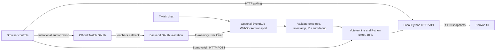

# Chat Mission Control

A local 2D rover rescue game where chat chooses the way home. Python owns mission state, breadth-first route planning, seven-second voting rounds and win/loss outcomes; vanilla HTML/CSS/JavaScript canvas shows the rover and its route.

Watch the [verified demo](https://youtu.be/bBtE758nlgI). It includes genuine game/chat footage and an explicitly edited later Codex follow-up, with privacy crops and labeled stills.

## Run locally

Python **3.9+** is required. From a checkout:

```sh
python3 -m venv .venv
.venv/bin/python -m pip install -r requirements.txt
.venv/bin/python server.py
```

Open **http://localhost:8000/**. The server binds **127.0.0.1**. Default mode is clearly labeled **simulated chat** and needs only Python stdlib; installing the pinned `websocket-client` dependency above prepares optional Twitch support. For hash-verified installation use `.venv/bin/python -m pip install --require-hashes -r requirements.lock`. No Node build or cloud service is required.

Deploy the rover, then vote north, scan or supply. Rounds last seven seconds; one vote per viewer per round, most votes wins, ties choose north → scan → supply, and no votes defaults north. North opens its crossing; scan opens central and trades 4 battery for 8 seconds of oxygen; supply opens south and adds 22 battery (cap 100) for 6 seconds of oxygen. Rescue the crew and reach shelter before resources run out. Restart prepares a fresh mission. The UI explains resource and route consequences.

## Architecture



The browser polls HTTP; it has no Twitch socket or token. Simulated votes and validated EventSub messages enter the backend through separate boundaries. Provider/socket interfaces are injectable for offline tests.

## Optional read-only Twitch

Live mode targets **balakrishnanayyanar** and requires operator-owned confidential-app credentials. Follow [TWITCH_SETUP.md](TWITCH_SETUP.md): private `.twitch-local/credentials.json`, directory mode 0700 and file mode 0600, using `twitch-config.example.json` as the empty template. Never commit credentials.

```sh
.venv/bin/python server.py --check-twitch-config
.venv/bin/python server.py --enable-twitch --port 8000
```

Use exactly **http://localhost:8000/**; registered callback is **http://localhost:8000/auth/twitch/callback**. Intentionally authorize only **`user:read:chat`**, then Connect chat. Subscription acknowledgement is distinct from notification delivery and an accepted vote. Simulated voting is disabled after verified live activation. No posting, moderation or broadcast control. Tokens remain backend memory only; server restart requires reauthorization. Live mode is off by default.

## Validation and limits

```sh
.venv/bin/python -m unittest discover -s tests -v
.venv/bin/python tools/check_source.py
```

Tests cover paths/outcomes/restart, voting/ties, OAuth/session/origin guards, timestamp freshness/dedup, mocked EventSub lifecycle and browser logic. Provider tests use fakes; loopback HTTP tests need local socket permission. Native JavaScriptCore UI tests run on macOS and skip elsewhere. The fixed public-source scanner is a heuristic, not a comprehensive secret audit.

[Curated live evidence](evidence/live-vote-verified.json) verifies one accepted live supply vote, one supply resolution (+22 battery / −6 oxygen) with route recalculation and rescue at 25.0 seconds, carrying the crew, ending with 12 battery / 34 oxygen. Exact intermediate route lengths were not retained. This is a verified single-mission demonstration, not production-load evidence.

Keep the foreground server alive. A phone cannot reach this computer's loopback address; this is not a hosted/mobile deployment. Full responsive coverage and actual live disconnect recovery are unverified. Reconnect/expiry failure paths have mocked coverage. Closing the backend loses in-memory authorization; browser loss does not pause a running mission.

## Built with Codex

Built and refined in the original persistent session **01a18a9f-83b7-7dc2-9144-78711c379fd4**, requested **gpt-6.1-sol / medium**. Codex implemented the authoritative game, canvas UI, guarded OAuth/EventSub integration and deterministic tests, then fixed Python 3.9 handling of Twitch nanosecond timestamps while retaining exact freshness limits. The demo's genuine later follow-up shows the same session's status, 12 relevant passing tests and the timestamp explanation; it is not recreated historical build footage.

This repository contains the playable runtime, tests, setup and sanitized evidence. Local video production, submission drafts and workspace notes are excluded; no submission status is implied.
